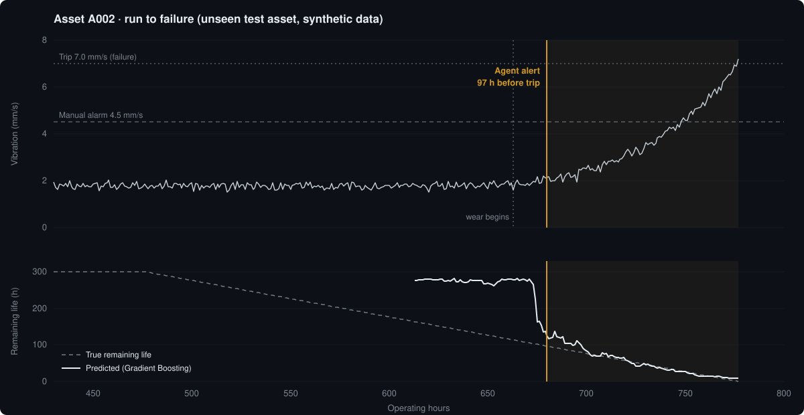
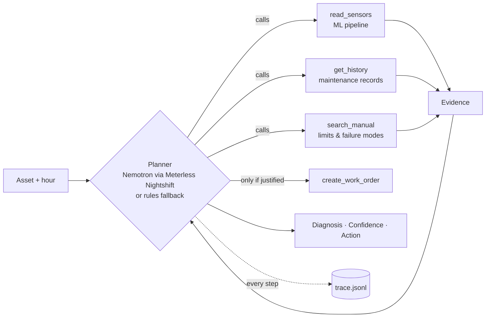

<p align="center">
  
</p>

<p align="center">
  <a href="https://github.com/pietrocdrachler/petro-mech-ai/actions/workflows/tests.yml"></a>
  
  
  
</p>

<p align="center">
  <b>Open Agent Hackathon 2026</b> by <a href="https://hackathon.genai.works/event/open-agent-hackathon-2026">GenAI.Works</a> · Track 02: <i>The Agent That Can Explain Why</i>
</p>

<p align="center">
  <a href="https://youtu.be/ylcaJ8-7U20"><b>▶ Watch the demo (2:44)</b></a> ·
  <a href="https://hackathon-server.genai.works/api/v1/cdn/proxy/hackathon/d3ec5be03bfe4d50894e90cd4852386c.pdf"><b>Slides</b></a> ·
  <a href="#quick-start">Quick start</a> ·
  <a href="#three-real-runs">Examples</a> ·
  <a href="#results-synthetic-data">Results</a> ·
  <a href="#limitations">Limitations</a>
</p>

---

## The problem

In Oil & Gas, an unplanned stop of a pump or compressor costs production, money and sometimes safety.
Condition monitoring systems raise alarms, but an alarm alone does not tell the maintenance planner
**what is happening, how sure we are, and what to do next**.

**Petro Mech AI** is an agent that monitors rotating equipment, decides which tools to call, and answers
every case with three things:

| Part | What it contains |
|---|---|
| **Diagnosis** | backed by numbers: vibration vs. baseline, hours above 3σ, anomaly score, remaining useful life |
| **Confidence & limits** | what the agent *cannot* know (for example, no frequency spectrum to separate bearing wear from misalignment) |
| **Action** | a work order with a priority, or an explicit *"no work order"* |

> [!IMPORTANT]
> **All data is synthetic.** The results show that the pipeline and the agent work end to end, not that
> the model is validated in the field. The real next step is a pilot with plant data.

<p align="center">
  
  <br><sub>Unseen test asset A002, generated from this repository's simulator and trained models. The agent raises its alert 97 h before the trip limit; predicted remaining life converges on the true value.</sub>
</p>

---

## How it works



### The agent's tools

| Tool | What it returns |
|---|---|
| `read_sensors` | Runs the ML pipeline: vibration and bearing temperature vs. baseline, hours above 3σ, anomaly score, alert flag, remaining useful life |
| `get_history` | Last bearing change, last oil analysis, last alignment, failures |
| `search_manual` | Alarm and trip limits, bearing wear, misalignment |
| `create_work_order` | Opens an order, only when the evidence justifies it |

### The ML pipeline

1. **Simulate.** Each asset runs healthy for 300 to 900 h, then bearing wear makes vibration, bearing
   temperature, pressure and motor current drift until vibration reaches the 7 mm/s trip limit.
2. **Features.** The first 150 h of each asset are its baseline. Each hour gets the z-score of every
   sensor against that baseline, a 24 h trend, and the vibration ratio.
3. **Anomaly.** An **Isolation Forest** learns only healthy behavior. The alert threshold is the 99.5th
   percentile of healthy training scores, and an alert needs 6 consecutive hours above it.
4. **Remaining useful life.** A **Gradient Boosting** regressor estimates hours to failure, capped at 300 h.

### Planner modes

| Mode | When | What happens |
|---|---|---|
| `model-chose-tools` | Meterless Nightshift configured | Nemotron gets the four tool definitions and decides which to call, in what order, and whether to open a work order |
| `evidence-first` | The model answers without using tools | The agent runs the tools itself, decides with the rules planner, and asks the model only to write the explanation. The switch is logged |
| `rules` | No `METERLESS_BASE_URL`, or a call fails | A transparent rule-based planner, so the repository always runs |

Every output states which planner and mode produced it.

---

## Quick start

```bash
git clone https://github.com/pietrocdrachler/petro-mech-ai.git
cd petro-mech-ai
pip install -r requirements.txt

python -m ml.train                            # simulate 90 assets, train, evaluate (~20 s on a laptop)
python -m agent.run --asset A002 --hour 737   # run the agent on one asset
pytest -q                                     # 8 tests
```

Without any keys this runs offline in under a minute with the rules planner.

<details>
<summary><b>Run with NVIDIA Nemotron through Meterless Nightshift</b></summary>

<br>

The agent's model calls go through **Meterless Nightshift** (here on a MacBook Air M2), using its
OpenAI-compatible endpoint. Nightshift holds the NVIDIA key, routes the calls to **NVIDIA Nemotron**
(`nemotron-3.5-lightning-30b-a3b`) and returns a signed compute receipt for each call, which the agent
stores in the trace.

```bash
export METERLESS_BASE_URL=http://127.0.0.1:8088/v1
export METERLESS_API_KEY=<Nightshift runtime auth token>
export METERLESS_MODEL=nvidia/nemotron-3.5-lightning-30b-a3b
python -m agent.run --examples   # regenerates examples/ with live model calls and receipts
```

</details>

---

## Three real runs

All three are test assets the models never saw in training. Each folder in [`examples/`](examples/)
has `input.json`, the agent's answer (`output.md`, `output.json`) and the step-by-step `trace.jsonl`.

| Example | What the tools return | Nemotron (live run) | Rules planner |
|---|---|---|---|
| [**Late bearing wear**](examples/late_bearing_wear/output.md)<br>`A002 @ 737 h` | vibration 3.68 mm/s (+106% vs. 1.79), 48 h above 3σ, bearing 55.7 → 64.9 °C, RUL ≈ 38 h | **medium-priority** work order | high priority |
| [**Early deviation**](examples/early_deviation/output.md)<br>`A004 @ 767 h` | vibration 1.85 mm/s (+22%), 6 h above 3σ, bearing +2.0 °C, RUL ≈ 155 h | **medium-priority** work order | medium priority |
| [**Healthy**](examples/healthy/output.md)<br>`A007 @ 300 h` | vibration 2.16 mm/s (−3%), never above 3σ, no failures in 12 months | **no work order** | no work order |

<details>
<summary><b>See the agent's full answer for A002</b></summary>

<br>

> **A002 at hour 737: medium risk, work order opened**
>
> **1) Probable diagnosis.** Asset A002 shows a vibration of 3.68 mm/s (105.9% above the 1.79 mm/s
> baseline) and has exceeded the 3-sigma threshold for 48 h. Bearing temperature is 64.9 °C, 9.2 °C above
> the 55.7 °C baseline. The anomaly score (0.729) exceeds the 0.585 threshold and the ML-estimated
> remaining useful life is 38 h. Manual section 7.2 flags sustained vibration rise above 3 sigma with
> rising bearing temperature as bearing-wear indicators.
>
> **2) Confidence & limits.** High confidence that the machine is trending toward a bearing-wear fault.
> Cannot definitively confirm bearing damage without a physical inspection and oil analysis; other causes
> (misalignment, looseness) are possible.
>
> **3) Action taken.** Opened work order **WO-1001** (medium priority) to inspect the bearing and take an
> oil sample per manual section 7.2.

</details>

On A002 the model chose medium priority where the rules planner chooses high, because the estimated
remaining life is under 100 h. Both decisions are visible in the output and the trace; making the model
follow the plant's escalation policy is the next step.

### Full traceability

Each run writes a `trace.jsonl` with one line per step: the input, every tool call with its arguments,
result and timing, the reasoning and decision rule, every model call with the model Nightshift routed to
and its compute receipt id, and the final output.
Example: [`examples/early_deviation/trace.jsonl`](examples/early_deviation/trace.jsonl).

---

## Results (synthetic data)

90 simulated assets, split **by asset**: 72 for training and 18 for testing that are never seen during
training, so no test hour leaks into the model. Seed 42:

<table>
  <tr>
    <td align="center"><h2>18 / 18</h2>failures detected<br>before trip</td>
    <td align="center"><h2>161 h</h2>median warning<br>before failure</td>
    <td align="center"><h2>12.1 h</h2>RUL error (MAE)<br>in the last 100 h</td>
    <td align="center"><h2>0</h2>false alarm episodes<br>per 1,000 healthy h</td>
  </tr>
</table>

Across five seeds (1 to 4 and 42) the results stay in the same range: 18/18 detected, median warning
124 to 161 h, RUL error 11 to 15 h, no false alarm episodes.

> [!WARNING]
> **Read these numbers with care.** The simulator produces one failure mode with a clean, monotonic
> signature, and an alert needs 6 consecutive anomalous hours. Real plant data is noisier and has several
> failure modes and operating changes, so real performance will be lower and the alert threshold will
> need recalibration.

---

## Repository structure

```
petro-mech-ai/
├── agent/
│   ├── run.py          # planner (Nemotron / evidence-first / rules), tracing, CLI
│   └── tools.py        # read_sensors, get_history, search_manual, create_work_order
├── ml/
│   ├── simulate.py     # synthetic run-to-failure data
│   ├── features.py     # baseline z-scores, 24 h trends, vibration ratio
│   └── train.py        # Isolation Forest + Gradient Boosting, evaluation -> metrics.json
├── examples/           # three live runs: input, output, trace
├── demo/               # notes on the web demo shown in the video
├── docs/img/           # README images
├── tests/              # pipeline and agent tests
└── metrics.json
```

The web demo shown in the video is a separate front end built on claude.ai: the same four tools over its
own simulated readings, with Claude choosing the tools. The agent in this repository is the version
connected to the ML pipeline.

---

## Limitations

- One failure mode (bearing wear); history and manual are synthetic stand-ins.
- No real data, no vibration spectrum, no validation with maintenance experts.
- Alert threshold calibrated only on simulated healthy data.
- The model's priority can differ from the plant's escalation rule (A002); the trace shows each decision.
- Zetaris not integrated yet.

## Progress

- [x] Synthetic simulator, features, anomaly detection and RUL model
- [x] Tool-calling agent with NVIDIA Nemotron and full traces
- [x] Automated tests

---

## Author

**Pietro Chiapinotto Drachler**, team lead and product. Engineering student at UFSM (Brazil).
Built during the Open Agent Hackathon 2026 (Oct 22–27, 2026).
